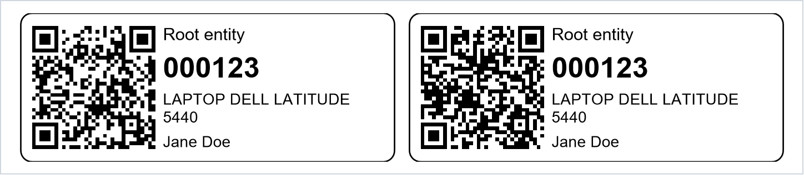
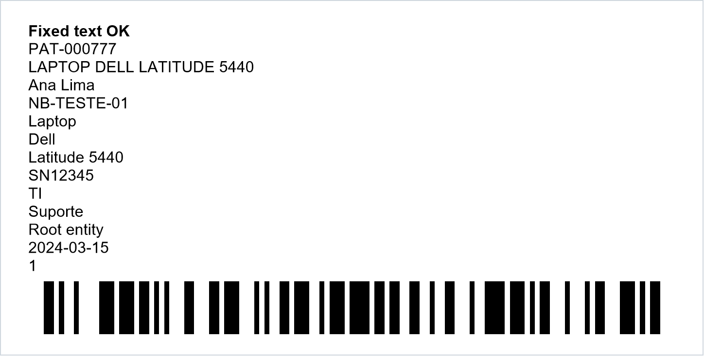

<p align="center">
  
</p>

<h1 align="center">Etiquetas</h1>

<p align="center">
  <b>Asset label printing for GLPI 11</b><br>
  QR code or barcode labels for the assets you select, laid out for thermal label printers.
</p>

<p align="center">
  <a href="https://github.com/carlosguilhermeklein/glpi-etiquetas/releases/latest"></a>
  
  
  <a href="LICENSE"></a>
  <a href="https://github.com/carlosguilhermeklein/glpi-etiquetas/releases"></a>
</p>

<p align="center">
  <b>English</b> · <a href="#português">Português</a>
</p>

<p align="center">
  
</p>

---

## Contents

- [Why](#why)
- [Features](#features)
- [Requirements](#requirements)
- [Installation](#installation)
- [Printing labels](#printing-labels)
- [Label templates](#label-templates)
- [Calibrating the printer](#calibrating-the-printer)
- [Command line](#command-line)
- [FAQ](#faq)
- [Translations and development](#translations-and-development)
- [License](#license)

## Why

GLPI 11 shows a QR code on every asset form, but it has no way to print labels for several assets
at once, and the older barcode plugins do not support GLPI 11. **Etiquetas** adds that missing step:
select the assets in any list, review the texts and get a PDF that matches your label roll,
whether it has one, two or more labels per row.

## Features

- **Print labels** massive action for computers, monitors, printers, network devices, peripherals
  and phones, available in the asset lists and in the *Actions* menu of each asset.
- **Review page** before printing: choose the template, check and edit the texts of each label.
  Assets without an inventory number are blocked when the template prints the number.
- **Label templates** with everything configurable from the GLPI interface:
  label size, labels per row, gaps, margins, printer resolution, QR code or Code 128 barcode,
  logo and text lines.
- **Logo upload** converted automatically to pure black and white at the printer resolution,
  because thermal printers have no grey.
- **Sharp printing**: QR code and barcode modules are aligned to the printer dots (203, 300 or 600 dpi).
- **Calibration PDF** that draws the outline of each label, to match the die-cut of the roll.
- **Translated**: English and Brazilian Portuguese.

<p align="center">
  <br>
  <sub>A 100 x 50 mm template showing every available field and a Code 128 barcode.</sub>
</p>

## Requirements

| Component | Version |
| --- | --- |
| GLPI | 11.0.x |
| PHP | 8.2 or later, with the `gd` extension (included in the official GLPI Docker image) |
| Printer | Any label printer with a Windows, macOS or Linux driver (Zebra and similar) |

## Installation

1. Download `glpi-etiquetas-<version>.tar.bz2` from the
   [latest release](https://github.com/carlosguilhermeklein/glpi-etiquetas/releases/latest).
2. Extract it into the GLPI `plugins` folder, or into `marketplace` on the official Docker image
   (`/var/glpi/marketplace`). The folder must be named `etiquetas`.
3. In GLPI, go to **Setup > Plugins**, then install and enable **Asset labels**. From the command line:

   ```bash
   php bin/console plugin:install -u glpi etiquetas
   php bin/console plugin:activate etiquetas
   ```

The installation creates a default template: 50 x 20 mm, 2 labels per row, QR code with the asset link.
Log out and in again to see **Label templates** in the **Setup** menu.

## Printing labels

1. Open an asset list, select the assets and choose **Actions > Print labels**
   (or use the *Actions* menu on an asset form).
2. On the review page, pick the template, check the texts and click **Generate PDF**.
3. Print the PDF on the label printer with the scale set to **actual size (100%)** and margins set to **none**.

Each page of the PDF is one row of the roll. With an odd number of labels on a two-column roll,
the last page uses only the left label.

## Label templates

Templates live in **Setup > Label templates**. Each one defines:

| Setting | Description |
| --- | --- |
| Label width and height | Size of one label, in millimetres |
| Labels per row | Number of columns of the roll (1 to 6) |
| Gap between columns, left margin | Position of the labels on the roll |
| Page width | Width of one row of the roll; `0` computes it from the values above |
| Vertical offset, inner margin | Fine adjustments of the content |
| Printer resolution | 203, 300 or 600 dpi, used to keep codes and logo sharp |
| Code | QR code (left or right) or Code 128 barcode (bottom), or none |
| Code content | Link to the asset in GLPI, inventory number, serial number or name |
| Logo | Image uploaded on the form, its position, size and black threshold |
| Text lines | Any number of lines, in any order, with font size, bold, uppercase and 1 to 3 rows |

Fields available on the text lines:

| Field | Example |
| --- | --- |
| Fixed text | `ACME - IT` |
| Inventory number | `PAT-000777` |
| Description (type + manufacturer + model) | `LAPTOP DELL LATITUDE 5440` |
| User (or location when there is no user) | `Ana Lima` |
| Name, type, manufacturer, model, serial number | `NB-01`, `Laptop`, `Dell`, `Latitude 5440`, `SN12345` |
| Location, group, entity | `IT`, `Support`, `ACME` |
| Purchase date, GLPI ID | `2024-03-15`, `1` |

The description, user and the other asset fields can be edited on the review page before printing;
the inventory number always comes from the asset.

## Calibrating the printer

1. In the printer driver, set the page size to one row of the roll:
   **page width x label height** (the page width is shown in the template summary, e.g. `104 mm`).
2. Open the template and click **Calibration PDF**. It prints sample labels with their outline.
3. Compare the outline with the die-cut of the labels and adjust the **left margin**,
   **gap between columns** and **vertical offset**. One to three test prints are usually enough.

## Command line

Build a PDF without the web interface, useful to test a layout:

```bash
php bin/console plugins:etiquetas:generate-pdf Computer:1 Monitor:3 --template=1 --output=/tmp/labels.pdf
php bin/console plugins:etiquetas:generate-pdf --calibration --output=/tmp/calibration.pdf
```

## FAQ

**The Label templates menu entry does not appear.**
GLPI builds the menu at login. Log out and in again after enabling the plugin.

**The QR code looks different every time I print the same asset.**
The PDF library bundled with GLPI (TCPDF) picks the QR mask pattern at random. The drawing changes,
but the content is the same and every version scans correctly.

**An asset is shown as "no number" and cannot be selected.**
The template prints the inventory number. Fill in the *Inventory number* field of the asset,
or use a template that does not print it.

**A text is too long for the label.**
Single-row texts are compressed horizontally. If all the lines do not fit in the height,
every font shrinks in the same proportion. You can also edit the text on the review page.

## Translations and development

- Source strings are in English; translations live in `locales/` (`etiquetas.pot` is the template).
  After editing a `.po` file, rebuild the `.mo` files with `php tools/compile-mo.php`.
- Publishing a GitHub release whose tag equals the version in `setup.php` (for example `1.2.0`)
  builds `glpi-etiquetas-<version>.tar.bz2` and attaches it to the release. `tools/release.sh`
  does the same locally.
- Bug reports and pull requests are welcome in the
  [issues](https://github.com/carlosguilhermeklein/glpi-etiquetas/issues).

## License

Distributed under the [GNU General Public License v3.0 or later](LICENSE).
Created by [cgklein](https://github.com/carlosguilhermeklein).

---

## Português

**Etiquetas** é um plugin gratuito para imprimir **etiquetas de patrimônio** no GLPI 11. Você marca só
os ativos que quer, confere os textos e recebe um PDF no formato do seu rolo de etiquetas
(uma, duas ou mais etiquetas por linha), pronto para impressoras térmicas como as Zebra.

### Recursos

- Ação **Imprimir etiquetas** nas listas de computadores, monitores, impressoras, dispositivos de rede,
  periféricos e telefones, e no menu *Ações* da ficha de cada ativo.
- **Tela de conferência**: escolha o modelo e ajuste os textos de cada etiqueta antes de gerar o PDF.
- **Modelos de etiqueta** configurados pela tela do GLPI: tamanho, colunas do rolo, margens, resolução da
  impressora, QR code ou código de barras Code 128, logo e linhas de texto.
- **Logo** convertido automaticamente para preto e branco na resolução da impressora.
- **PDF de calibração** com o contorno de cada etiqueta, para alinhar com o corte do rolo.
- Interface em **português do Brasil** e inglês.

### Instalação

1. Baixe `glpi-etiquetas-<versão>.tar.bz2` na [última versão](https://github.com/carlosguilhermeklein/glpi-etiquetas/releases/latest).
2. Extraia na pasta `plugins` do GLPI (ou em `/var/glpi/marketplace` na imagem Docker oficial).
   A pasta precisa se chamar `etiquetas`.
3. No GLPI, vá em **Configurar > Plug-ins**, instale e ative **Etiquetas de patrimônio**.
4. Saia e entre de novo para ver **Modelos de etiqueta** no menu **Configurar**.

### Como imprimir

1. Numa lista de ativos, marque os itens e use **Ações > Imprimir etiquetas**.
2. Na tela de conferência, escolha o modelo, confira os textos e clique em **Gerar PDF**.
3. Imprima com escala **Tamanho real (100%)** e margens **Nenhuma**.

### Calibração

No driver da impressora, configure o tamanho da página como uma linha do rolo
(**largura da página x altura da etiqueta**). Depois imprima o **PDF de calibração** do modelo e ajuste
a margem esquerda, o espaço entre as colunas e o deslocamento vertical até o contorno coincidir com o corte.

### Licença

Software livre sob a [GPL v3 ou posterior](LICENSE). Criado por [cgklein](https://github.com/carlosguilhermeklein).
